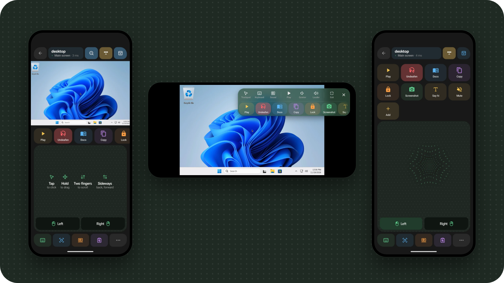

<div align="center">
  
  <h1>Weave</h1>
  <p>Your computer, run from your <b>Android phone</b>: its <b>screen</b> at the top, a <b>trackpad</b> under your thumb,<br/>
  your phone's own <b>keyboard</b>, <b>shortcuts</b>, sound and the clipboard. For <b>Windows</b> and <b>Linux</b>.</p>
  <p>
    <a href="https://github.com/T3lluz/Weave/releases/latest"></a>
    
    
    <a href="https://github.com/T3lluz/Weave/actions/workflows/release.yml"></a>
    <a href="https://github.com/T3lluz/Weave/actions/workflows/computer.yml"></a>
  </p>
  <p><a href="#install"><b>Install</b></a> · <a href="#features">Features</a> · <a href="#use">Use</a> · <a href="#commands">Commands</a> · <a href="#ai-shortcuts">AI shortcuts</a> · <a href="#build">Build</a> · <a href="https://t3lluz.com/weave">t3lluz.com/weave</a></p>
  
</div>

## Features

- **The screen, live:** every monitor. Pinch to zoom. The view follows the pointer and slides across when the pointer moves to another monitor.
- **A trackpad that keeps up:** the phone draws the pointer itself, so it moves the moment your finger does. One finger moves, a tap clicks, two fingers scroll, a two-finger tap is the right button, and two fingers swept sideways go back and forward.
- **Hold to drag, with any finger:** once a held finger has taken hold, another can carry what you hold while the first stays put. The drag ends when the last finger lifts.
- **You can feel it:** the pad has a faint grain under your finger, its buttons click down and up, and a shortcut of several steps says when it is done.
- **Your phone's keyboard:** autocorrect, swipe typing and any language, typed on the computer. It comes up by itself when a click lands in a text field.
- **Shortcuts:** one step or several in a row. Bring an app to the front, open a page, press keys, type, wait. A shortcut can flip between two looks, like Deafen and Undeafen.
- **Shortcuts from a few words:** describe one to Claude ("deafen me on Discord") and it plans the steps and picks the icon.
- **A home screen widget:** runs shortcuts without opening Weave. Pick two to eight and they size themselves to fill it.
- **Fold what you don't need:** fold the screen away and the phone is one big trackpad. Fold the shortcuts away and the pad gets their room.
- **Full screen:** turn the phone on its side and the computer's screen fills it. The controls and your shortcuts sit in one glass panel in the corner, which folds to a single button after a few seconds.
- **Sound, clipboard, lock and wake:** the computer's sound on the phone, the phone's sound on the computer, media keys, the clipboard both ways or kept in sync, lock, and wake from sleep on the same network.
- **Sound that follows your earbuds (beta):** walk away from the computer with your earbuds in and the phone takes them over and plays the computer's sound, while the computer goes quiet. Come back and the computer takes them back. Turn it on in Settings, Labs. The computer's side needs Linux.
- **No account, no cloud:** the phone talks straight to the computer, on your own network or over [Tailscale](https://tailscale.com).

## Install

1. **On the computer.** Linux with Hyprland:

   ```bash
   curl -fsSL https://t3lluz.com/weave/install.sh | sh
   ```

   Windows 10 and 11, in PowerShell:

   ```powershell
   irm https://t3lluz.com/weave/install.ps1 | iex
   ```

   Neither needs root or admin. Both start Weave now and at every login.

2. **On the phone.** The APK from [Releases](https://github.com/T3lluz/Weave/releases/latest) or [t3lluz.com/weave](https://t3lluz.com/weave). Android 8 and up. Weave keeps itself up to date after that.
3. **Pair them.** The installer ends by showing a code. In the app, tap **Scan a code**.

Later, `weave pair` on the computer shows a new code. Computers on the same Wi-Fi also show up in the app by themselves, and **By address** takes an address or a Tailscale name. Either way the computer asks once whether to let the phone in.

The computer side has its own page: [`computer/`](computer/README.md).

## Use

| Input | Action |
|---|---|
| One finger | Move the pointer |
| Tap | Click |
| Two-finger tap, three-finger tap | Right button, middle button |
| Hold, then move | Drag. Any finger carries it once it has hold |
| Two fingers | Scroll |
| Two fingers swept sideways | Back and forward |
| **Left** and **Right** at the pad's foot | Hold a mouse button down while another finger moves |
| Tap the screen | Click there |
| Pinch the screen | Zoom |
| The tiles at the top | Leave, open the sheet, zoom, fold the shortcuts or the screen away |
| The dock | Keyboard, full screen, the computer's sound here, clipboard, more |
| Hold a shortcut | Change, arrange or remove it |

## Commands

On the computer:

```
weave pair            show a code for a phone to scan
weave status          what is connected and running
weave allow | deny    answer a phone waiting to pair
weave forget [NAME]   unpair a phone, or all of them
weave clip            send this clipboard to the phone
```

## AI shortcuts

Settings → AI signs in to Claude with your Claude plan, or takes an API key. The model list is your account's own, read from Anthropic, and the effort slider sets how hard it thinks.

## Where it works from

On the same network, or anywhere over Tailscale. One scan covers both: the code carries every address the computer has.

Weave doesn't encrypt what the phone and the computer say to each other. Tailscale does. On a plain local network it is as private as that network. A phone gets in only with a code from the computer's screen, or after you say yes on the computer.

## Build

```bash
./gradlew :app:assembleDebug
./gradlew :app:testDebugUnitTest
```

JDK 17, Android SDK 36, Android 8.0 and up. The computer side's tests: `cd computer && python3 -m unittest discover -s tests`.

Every push to `master` that changes the app builds a signed APK and publishes it as a release. The site at [t3lluz.com/weave](https://t3lluz.com/weave) is [`site/`](site), deployed from `master`.

## Credits

Weave started as the Laptop screen in [DailyDash](https://github.com/T3lluz/DailyDash), copied out on 2026-11-18. The pointer is the macOS27-GoldenGate cursor theme's arrow, as installed on the laptop. The site is set in [Google Sans Flex](site/public/fonts/OFL.txt), under the SIL Open Font License.
